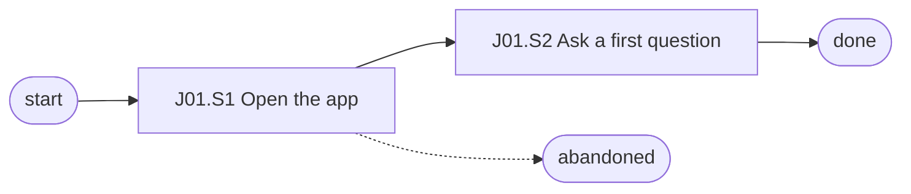

# J01 — First start

**Stage:** explore. **Release:** <milestone link>.

<One or two sentences: who the user is, what they want to get done, and how they know it worked.>

## Flow *(proposal)*

One pass runs from `start` until <the outcome> (`done`) or the user leaves (`abandoned`). A `done` row names the scenario that ends the pass. Time budgets come from "Non-functional".

| From | To | When | Time budget |
|---|---|---|---|
| start | J01.S1 | the user opens the app | — |
| J01.S1 | J01.S2 | the user types a first question | 2 min |
| J01.S2 | done | First answer shown | 30 s |

## Non-functional

- Time from launch to a usable window: threshold open, measure first.

## Requirements

### Requirement: J01.S1 Open the app

The app SHALL show a usable window without asking for anything first.

#### Scenario: First launch *(proposal)*

- WHEN the user opens the app for the first time
- THEN a window shows where they can type a question
- AND no account or setting is required before typing

### Requirement: J01.S2 Ask a first question

The app SHALL answer the first question in the same window.

#### Scenario: First answer shown *(proposal)*

- WHEN the user sends a question
- THEN the first words of the answer appear within the time budget

### Requirement: J01.U1 A draft is never lost

The app SHALL NOT lose what the user typed when sending fails.

#### Scenario: Sending fails *(proposal)*

- WHEN sending the first question fails
- THEN the typed question stays in the input
- AND the user sees what happened and a way to try again
